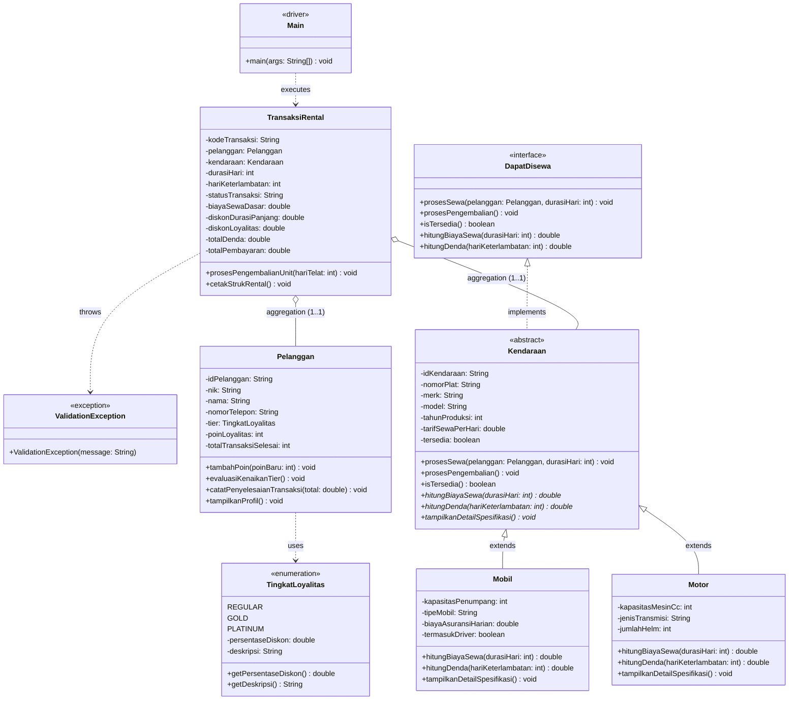

# UJIAN TENGAH SEMESTER (ETS) PRAKTIKUM PEMROGRAMAN BERORIENTASI OBJEK
## Tipe A - Sistem Rental Kendaraan (AutoRent Architecture)

* **Mata Kuliah** : Praktikum Pemrograman Berorientasi Obyek
* **Dosen Pengampu**: Nirwana Haidar Hari, S.Pd., M.Kom.
* **Institusi**    : Politeknik Elektronika Negeri Surabaya (PENS) - PSDKU Sumenep
* **Program Studi**: D3 Teknik Informatika
* **Mahasiswa**    : Ahmad Yasar Maulana Dais
* **NRP**          : 3125522018
* **Kelas**        : 3D3PSDKU-SM-IT A

---

## 1. Struktur Folder & Berkas Proyek

Struktur direktori pengumpulan disusun sesuai format standar luaran ETS:
```text
UTS_3125522018_Ahmad Yasar Maulana Dais/
│
├── class-diagram.pdf             # UML Class Diagram (Format PDF A4 Landscape)
├── class-diagram.png             # UML Class Diagram (Format Gambar Hi-Res)
├── README.md                     # Dokumentasi arsitektur, rubrik, dan panduan demo
├── generate_diagram.py           # Generator diagram otomatis (PIL & ReportLab)
└── src/
    ├── DapatDisewa.java          # [Interface] Kontrak operasional penyewaan
    ├── TingkatLoyalitas.java     # [Enum] Tingkatan member pelanggan & diskon
    ├── ValidationException.java  # [Custom Exception] Penanganan aturan bisnis
    ├── Kendaraan.java            # [Abstract Class] Superclass armada rental
    ├── Mobil.java                # [Subclass] Implementasi armada roda empat
    ├── Motor.java                # [Subclass] Implementasi armada roda dua
    ├── Pelanggan.java            # [Entity Class] Master penyewa & sistem loyalitas
    ├── TransaksiRental.java      # [Transaction Class] Relasi agregasi, kalkulasi, & struk
    └── Main.java                 # [Driver Class] Skenario pengujian lengkap
```

---

## 2. Pemenuhan 100% Rubrik Penilaian ETS

| Komponen Penilaian | Bobot | Ketentuan Soal | Implementasi dalam Program |
| :--- | :---: | :--- | :--- |
| **Analisis Masalah & Kualitas Class Diagram** | 20% | Arsitektur rapi, diagram komprehensif | 9 kelas/komponen modular, UML diagram lengkap tersedia dalam format PDF, PNG, dan Mermaid. |
| **Encapsulation, Validation & Relationship** | 20% | Atribut `private` + getter/setter terkontrol, min. 2 business rules, min. 2 relasi antar-objek | Semua atribut berakses `private`. Terdapat 4 aturan bisnis (ketersediaan unit, tarif > 0, NIK 16 digit, durasi >= 1). Relasi Agregasi `TransaksiRental` -> `Pelanggan` dan `TransaksiRental` -> `Kendaraan`. |
| **Inheritance & Abstract Class** | 20% | Min. 1 abstract class, min. 1 superclass + 2 subclass | `Kendaraan` sebagai abstract class mewariskan properti dan method ke `Mobil` dan `Motor`. |
| **Polymorphism & Interface** | 20% | Min. 1 interface, min. 1 method overriding dengan kalkulasi berbeda | Interface `DapatDisewa`. Method overriding polymorphic: `hitungBiayaSewa()`, `hitungDenda()`, dan `tampilkanDetailSpesifikasi()`. |
| **Program Berjalan & Skenario Pengujian** | 10% | Min. 3 objek master, skenario transaksi, validasi bisnis, pemanggilan polymorphic | `Main.java` menginstansiasi 4 kendaraan dan 2 pelanggan, menjalankan transaksi sukses, memicu 4 test case validasi, kalkulasi denda, dan pencetakan 2 struk nota resmi. |
| **Kreativitas Solusi** | 10% | Logika bisnis orisinal ciptaan sendiri | Diskon sewa durasi panjang otomatis (3-14 hari), sistem poin loyalitas dinamis & kenaikan level membership otomatis, denda keterlambatan berbeda per armada, serta struk nota rental profesional. |
| **TOTAL** | **100%** | **Sangat Memenuhi Standar Kelulusan Maksimal** | **Siap Demo & Eksekusi Langsung** |

---

## 3. Diagram UML (Mermaid)



---

## 4. Panduan Demo 3 Menit (Poin Presentasi di Depan Dosen)

Saat diminta mempresentasikan program, sampaikan poin kunci berikut secara sistematis:

### 1. "Mengapa saya merancang class seperti ini?"
* **Pemisahan Tanggung Jawab (Separation of Concerns)**:
  * `Kendaraan` bertindak sebagai Superclass Abstrak yang menampung atribut umum armada (plat, tarif, merk, ketersediaan) sehingga mencegah duplikasi kode (*DRY principle*).
  * `Mobil` dan `Motor` mewarisi `Kendaraan` dengan atribut spesifik masing-masing (mobil memiliki asuransi dan supir; motor memiliki tipe transmisi CVT dan fasilitas helm).
  * `Pelanggan` dan `TransaksiRental` dipisahkan dengan relasi **Agregasi**, karena pelanggan merupakan entitas independen yang riwayatnya tetap ada meskipun transaksi telah selesai.
  * `DapatDisewa` dijadikan Interface untuk standarisasi kontrak operasional rental.

### 2. "Di mana polymorphism terjadi?"
* **Polymorphism pada Method Overriding**:
  * `hitungBiayaSewa(durasi)`: Pada **Mobil**, biaya ditambahkan premi asuransi harian, biaya supir, dan diskon paket mingguan (>= 7 hari). Pada **Motor**, biaya memperhitungkan surcharge CVT matic dan diskon commuter (>= 5 hari).
  * `hitungDenda(hariTelat)`: Pada **Mobil**, denda sebesar 150% tarif harian ditambah biaya administrasi reposisi armada Rp 50.000. Pada **Motor**, denda adalah 120% tarif harian tanpa biaya administrasi mobil.
* **Polymorphism pada Dynamic Dispatch**:
  * Pada `Main.java`, armada disimpan dalam referensi superclass `List<Kendaraan>` / `Kendaraan[]`. Saat perulangan memanggil `k.hitungBiayaSewa()`, JVM secara otomatis mengeksekusi implementasi subclass yang bersesuaian di runtime.

### 3. "Apa fitur kreatif yang saya tambahkan?"
1. **Dynamic Customer Loyalty & Tier Upgrade**: Sistem poin reward (1 poin per Rp 50.000 pembayaran). Pelanggan secara otomatis naik level dari *Regular* -> *Gold* -> *Platinum* berdasarkan akumulasi poin dan histori transaksi.
2. **Diskon Bertingkat Otomatis (Tiered Duration Discount)**: Diskon durasi panjang dihitung otomatis (3-6 hari: 5%, 7-13 hari: 10%, >=14 hari: 15%), digabung dengan diskon membership pelanggan.
3. **Pencetakan Struk Nota Resmi**: Metode `cetakStrukRental()` menghasilkan rincian transaksi berformat monospaced ASCII yang estetik, memisahkan subtotal, diskon, denda, dan perolehan poin member.

---

## 5. Cara Menjalankan Program

### Melalui Terminal / Command Prompt:
```bash
# Pindah ke direktori src
cd "UTS_3125522018_Ahmad Yasar Maulana Dais/src"

# Kompilasi seluruh berkas Java
javac *.java

# Jalankan program Main
java Main
```

### Melalui NetBeans / IntelliJ IDEA:
1. Buka folder `UTS_3125522018_Ahmad Yasar Maulana Dais` sebagai project atau buka langsung folder `src/`.
2. Pastikan SDK Java terdeteksi (Java 8, 11, 17, 21, atau 25).
3. Klik kanan pada berkas `Main.java` -> pilih **Run 'Main.main()'** (Shift + F6 di NetBeans).
